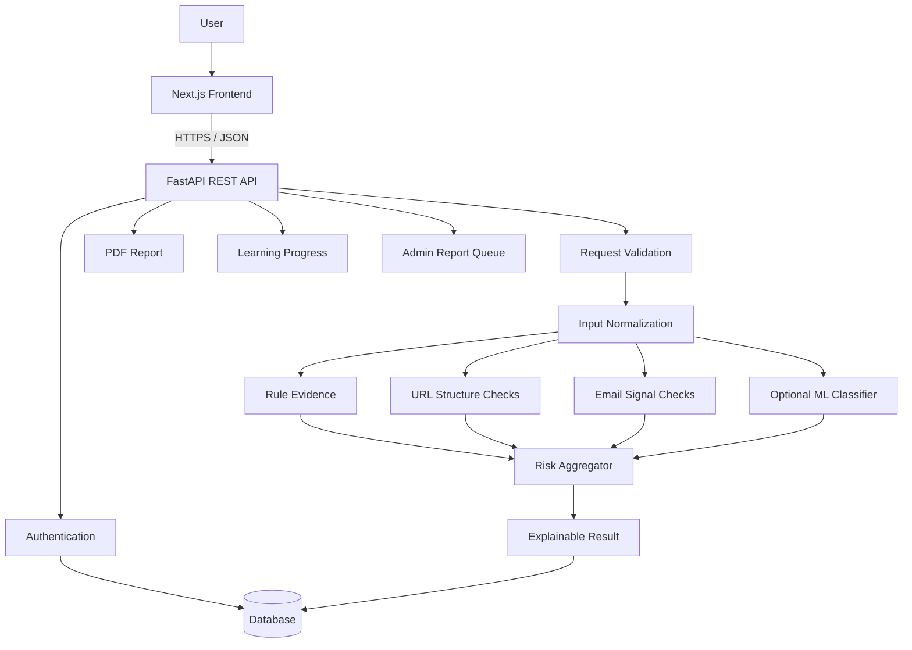
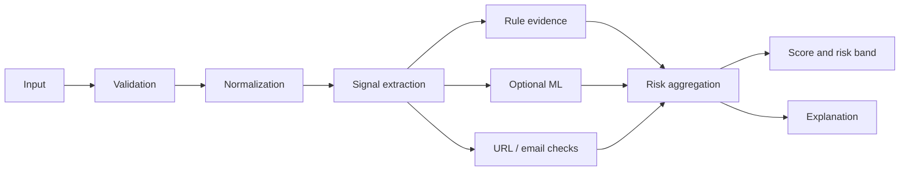
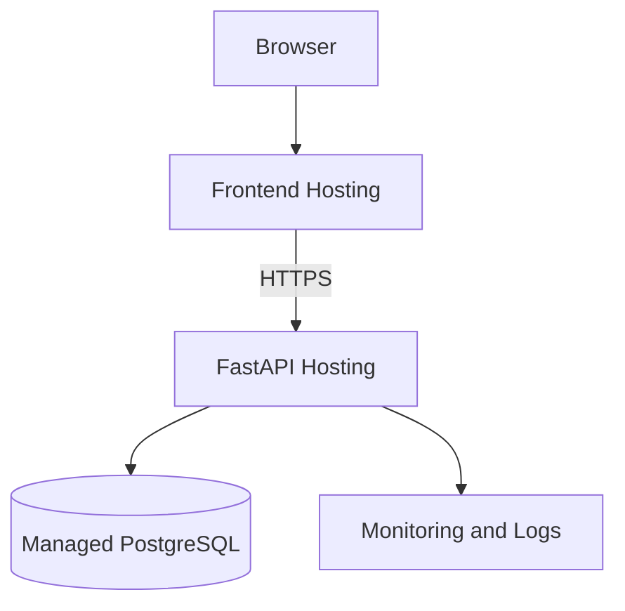

<div align="center">

# 🛡️ ScamShield AI

### Think Before You Click. Detect Before You Trust.

**An explainable scam-risk analysis platform for suspicious messages, URLs, and email content.**

<br/>

<!-- Primary technology badges -->
<p>
  
  &nbsp;
  
  &nbsp;
  
  &nbsp;
  
</p>

<p>
  
  &nbsp;
  
  &nbsp;
  
  &nbsp;
  
</p>

<br/>

<p>
  <a href="#-overview">Overview</a>
  &nbsp;·&nbsp;
  <a href="#-features">Features</a>
  &nbsp;·&nbsp;
  <a href="#-architecture">Architecture</a>
  &nbsp;·&nbsp;
  <a href="#-quick-start">Quick Start</a>
  &nbsp;·&nbsp;
  <a href="#-api-reference">API</a>
  &nbsp;·&nbsp;
  <a href="#-security-and-privacy">Security</a>
</p>

</div>

> [!IMPORTANT]
> ScamShield AI is a decision-support and awareness tool. It does not guarantee that a message, sender, website, or attachment is safe. A low-risk result does not prove legitimacy. Never share passwords, OTPs, recovery codes, or payment details with an untrusted party.

---

## 🧭 Overview

ScamShield AI helps people inspect suspicious digital communication before acting on it. It analyzes supplied message text, URL structure, and selected email metadata; identifies configured warning indicators; and explains the evidence behind a heuristic risk score.

### The problem

Scams commonly use urgency, impersonation, fake rewards, upfront job fees, payment pressure, and links that imitate trusted services. People often need to make a decision before they can confidently interpret these signals.

### The approach

1. Submit a message, URL, or email details.
2. Validate and normalize the input.
3. Extract relevant indicators.
4. Aggregate rule evidence and optional model output.
5. Return a bounded risk score and risk band.
6. Explain observed signals and safer next steps.
7. Save the scan for the authenticated user's history.

### Product principle

**Explain the evidence, not just the score.**

A single number is not enough. Users should understand why something was flagged, what was checked, what was not checked, and what action is safer.

### Project facts

| Property | Details |
|---|---|
| Project | ScamShield AI |
| Purpose | Scam-risk analysis and awareness |
| Frontend | Next.js, React, TypeScript, Tailwind CSS |
| Backend | Python, FastAPI, Pydantic |
| Persistence | SQLAlchemy, PostgreSQL / SQLite development option |
| Detection | Explainable rules + optional scikit-learn model |
| Inputs | Messages, URLs, email text and metadata |
| Output | Risk score, risk band, category, evidence, recommendations |
| Maturity | Development / educational project |
| Security audit | Not independently audited |

## 🗺️ Table of contents

- [Overview](#-overview)
- [Features](#-features)
- [Architecture](#-architecture)
- [Technology stack](#-technology-stack)
- [Repository structure](#-repository-structure)
- [Quick start](#-quick-start)
- [Backend setup](#-backend-setup)
- [Frontend setup](#-frontend-setup)
- [Environment configuration](#-environment-configuration)
- [Detection engine](#-detection-engine)
- [Machine learning](#-machine-learning)
- [API reference](#-api-reference)
- [Testing](#-testing)
- [Security and privacy](#-security-and-privacy)
- [Design system](#-design-system)
- [Deployment](#-deployment)
- [Limitations and roadmap](#-limitations-and-roadmap)
- [Contributing](#-contributing)
- [Troubleshooting](#-troubleshooting)
- [Appendices](#-appendices)

---

## ✨ Features

### Message scanner
- Analyze copied SMS, chat messages, and text.
- Detect configured urgency and pressure patterns.
- Identify requests for OTPs, passwords, and credentials.
- Flag payment, prize, job-fee, and link-bait patterns.
- Return evidence alongside a risk assessment.

### URL intelligence
- Parse a submitted URL without opening it.
- Inspect scheme, host, path, and selected URL structure.
- Flag structural indicators such as plain HTTP, IP hosts, punycode, unusual authority syntax, long URLs, and multiple subdomains.
- Explain that structure checks are not a live reputation verdict.

### Email analyzer
- Inspect supplied subject and body text.
- Compare sender and reply-to domains when provided.
- Flag selected risky attachment filename extensions.
- Detect urgency and credential-request language.
- Never execute or download an attachment.

### Explainable risk engine
- Aggregate configured evidence into a bounded score.
- Map scores to Low, Medium, High, and Critical.
- Present reasons and safer next actions.
- Keep model confidence distinct from risk score.
- Avoid presenting a heuristic score as a probability.

### Scan history and reports
- Persist authenticated users' scan records.
- Browse previous scans and open details.
- Export an individual scan report as PDF.
- Submit feedback about scan quality.

### Dashboard and academy
- Display activity derived from persisted records.
- Browse scam-awareness lessons.
- Save lesson completion progress.
- Learn practical verification habits.

### Scam reporting and administration
- Submit suspected scam reports.
- Review reports through admin-authorized endpoints.
- Update report status through the moderation workflow.

### Batch analysis
- Submit multiple messages through the batch API.
- Receive an analysis result for each accepted item.
- Use the endpoint for controlled testing and integrations.

### Optional ML baseline
- Train TF-IDF + Logistic Regression from a CSV dataset.
- Save a local model artifact.
- Load the artifact when available.
- Retain rule-based analysis when no model artifact exists.

## 🧱 Architecture



### Request lifecycle

1. Browser collects input and scan type.
2. Frontend sends JSON to FastAPI.
3. Pydantic validates the request.
4. Authentication identifies the user for protected operations.
5. Detection modules inspect the supplied content.
6. Evidence is aggregated into a score and category.
7. The API stores the scan and its evidence.
8. The frontend renders the result.
9. The user can inspect, export, or provide feedback.

### Layer responsibilities

| Layer | Responsibility | Boundary |
|---|---|---|
| Frontend | Input and result presentation | Never decides API authorization |
| API | Validation and orchestration | Never trusts client-provided user identity |
| Detection | Extract evidence | Never claims certainty from heuristics |
| Authentication | Verify identity and permissions | Never exposes password hashes |
| Database | Persist users and scans | Avoids unnecessary secret storage |
| Reporting | Format scan output | Does not change detection outcome |
| Admin | Moderate reports | Requires server-side authorization |

## 🧰 Technology stack

| Technology | Purpose |
|---|---|
| Python | Backend language |
| FastAPI | REST API framework |
| Pydantic | Request / response validation |
| SQLAlchemy | ORM and persistence |
| PostgreSQL | Containerized relational database |
| SQLite | Lightweight development database option |
| scikit-learn | Optional text classifier |
| TF-IDF | Text feature extraction |
| Logistic Regression | Baseline classifier |
| Next.js | Frontend framework |
| React | UI components |
| TypeScript | Frontend type safety |
| Tailwind CSS | Styling |
| Docker Compose | Local service orchestration |
| Pytest | Backend tests |

## 🗂️ Repository structure

```text
scamshield-ai/
├── backend/
│   ├── app/
│   │   ├── main.py
│   │   ├── config.py
│   │   ├── database.py
│   │   ├── models.py
│   │   ├── schemas.py
│   │   ├── security.py
│   │   ├── detection.py
│   │   └── ml/
│   │       ├── train.py
│   │       └── artifacts/
│   ├── tests/
│   │   ├── test_detection.py
│   │   └── test_api.py
│   ├── requirements.txt
│   └── Dockerfile
├── frontend/
│   ├── src/
│   │   ├── app/
│   │   │   ├── dashboard/
│   │   │   ├── scanner/
│   │   │   ├── url-analyzer/
│   │   │   ├── email-analyzer/
│   │   │   ├── history/
│   │   │   ├── academy/
│   │   │   ├── reports/
│   │   │   ├── settings/
│   │   │   └── admin/
│   │   ├── components/
│   │   └── lib/
│   ├── package.json
│   └── configuration files
├── docker-compose.yml
├── .env.example
└── README.md
```

The tree highlights the principal modules. Minor configuration files and generated artifacts are omitted.

## ⚡ Quick start

### Prerequisites

- Git
- Python 3.11 or a compatible version
- Node.js LTS
- npm
- Docker Desktop (recommended for PostgreSQL)
- PowerShell, Windows Terminal, Bash, or another terminal

Verify installations:

```bash
git --version
python --version
node --version
npm --version
docker --version
docker compose version
```

### Clone

```bash
git clone https://github.com/YOUR_USERNAME/scamshield-ai.git
cd scamshield-ai
```

Replace `YOUR_USERNAME` with the GitHub account that owns the repository.

### Configure environment

PowerShell:

```powershell
Copy-Item .env.example .env
```

macOS / Linux:

```bash
cp .env.example .env
```

Review `.env.example` and configure the values required by the current checkout. Never commit real credentials.

### Docker startup

```bash
docker compose up --build
```

Open the local services:

| Service | Address |
|---|---|
| Frontend | http://localhost:3000 |
| API | http://localhost:8000 |
| Swagger docs | http://localhost:8000/docs |
| Health check | http://localhost:8000/api/health |

Stop services:

```bash
docker compose down
```

To delete local named volumes as well, only when you intentionally want to erase local database data:

```bash
docker compose down -v
```

> [!WARNING]
> The `-v` option deletes compose-managed volumes. Do not use it if you need to preserve local scans and user records.

## 🐍 Backend setup

### Windows PowerShell

```powershell
cd backend
python -m venv .venv
.\.venv\Scripts\Activate.ps1
python -m pip install --upgrade pip
pip install -r requirements.txt
uvicorn app.main:app --reload --port 8000
```

If activation is blocked, call the environment executable directly:

```powershell
.\.venv\Scripts\python.exe -m pip install -r requirements.txt
.\.venv\Scripts\python.exe -m uvicorn app.main:app --reload --port 8000
```

### macOS / Linux

```bash
cd backend
python3 -m venv .venv
source .venv/bin/activate
python -m pip install --upgrade pip
pip install -r requirements.txt
uvicorn app.main:app --reload --port 8000
```

### Health check

```text
http://localhost:8000/api/health
```

Expected response shape:

```json
{
  "status": "ok",
  "service": "ScamShield AI API"
}
```

### API documentation

```text
http://localhost:8000/docs
```

Use Swagger UI to inspect the exact request schemas and test endpoints. Protected endpoints require a valid access token.

## ⚛️ Frontend setup

Open a second terminal:

```bash
cd frontend
npm install
npm run dev
```

Open:

```text
http://localhost:3000
```

### Production build

```bash
npm run build
```

A successful development server does not prove that the production build is valid. Run the build before deployment.

### API base URL

Inspect `frontend/src/lib/api.ts` and the environment example to identify the exact API base URL variable used by this checkout. For local development, it should point to:

```text
http://localhost:8000
```

Do not create a new environment variable name without checking the API client.

## 🔐 Environment configuration

Use `.env.example` as the source of truth for required variable names.

| Configuration | Purpose | Sensitivity |
|---|---|---|
| Database URL | Database connection | Secret |
| JWT signing secret | Token signing | High sensitivity |
| Token expiry | Access-token lifetime | Configuration |
| CORS origins | Browser origin allowlist | Configuration |
| Frontend API URL | Browser API destination | Public configuration |
| Environment mode | Development / production behavior | Configuration |

### Secret rules

- Generate a unique high-entropy signing secret for production.
- Never reuse a development secret in production.
- Never expose backend secrets through `NEXT_PUBLIC_` variables.
- Never commit `.env`, tokens, passwords, or private keys.
- Rotate any secret that is accidentally exposed.
- Use separate credentials for development, staging, and production.
- Restrict database network access.
- Prefer a managed secret store in production.

Generate a secret:

```bash
python -c "import secrets; print(secrets.token_urlsafe(48))"
```

Keep the generated value private.

## 🧠 Detection engine

The detection pipeline combines rule-based indicators with an optional machine-learning classifier. The result should explain the evidence rather than return an unexplained label.

### Detection flow



### Rule families

| Signal | Example |
|---|---|
| Credential request | Requests OTP, password, PIN, or login details |
| Urgency | Threat of immediate suspension or closure |
| Payment pressure | Pay a fee to unlock an opportunity |
| Prize bait | Claim of unexpected reward requiring action |
| Job fee | Registration or interview fee language |
| Link bait | Click to verify or claim something |
| Banking impersonation | Language imitating a bank or account provider |

### URL structure indicators

- URL scheme.
- Hostname shape.
- IP-address host.
- Punycode representation.
- Unusual authority syntax.
- Excessive URL length.
- Number of subdomains.
- Selected path keywords.
- Plain HTTP rather than HTTPS.

HTTPS encrypts a connection; it does not prove that a website is legitimate.

### Email indicators

- Subject and body text.
- Sender domain.
- Reply-to domain.
- Sender / reply-to mismatch.
- Selected risky attachment filename extensions.

The analyzer does not inspect attachment contents. Filename inspection is not malware scanning.

### Risk bands

| Score | Label | Meaning |
|---:|---|---|
| 0–24 | Low | Few configured warning indicators |
| 25–49 | Medium | Some warning indicators |
| 50–74 | High | Multiple or stronger warning indicators |
| 75–100 | Critical | Strong combination of configured indicators |

These are application thresholds, not universal cybersecurity standards.

### Risk score versus confidence

- Risk score is the output of evidence aggregation.
- Risk level is the band assigned to the score.
- Model confidence is a classifier-specific estimate, when available.
- Neither value guarantees the true safety or maliciousness of content.

A confident model can still be wrong when input differs from training data.

## 🤖 Machine learning

The optional baseline uses TF-IDF vectorization and Logistic Regression.

### Training data format

CSV columns:

```csv
text,label
"Your account has been credited with salary",legitimate
"Send your OTP to claim the prize",phishing
"Meeting starts at 10 AM tomorrow",legitimate
"Pay a registration fee to confirm the job",scam
```

Use consistent labels and inspect the training script for supported class handling.

### Train the model

From `backend`:

```bash
python -m app.ml.train --input datasets/messages.csv --text-column text --label-column label
```

Inspect available arguments:

```bash
python -m app.ml.train --help
```

### Model artifact

```text
backend/app/ml/artifacts/message_model.joblib
```

The backend can load this artifact when present. Keep generated model files out of source control unless intentionally tracking a small, licensed artifact.

### Evaluation requirements

- Split data into train, validation, and test sets.
- Use stratification where appropriate.
- Report precision, recall, F1-score, and confusion matrix.
- Inspect false negatives and false positives separately.
- Avoid duplicate or near-duplicate samples across splits.
- Document dataset source, license, date, and preprocessing.
- Evaluate on data not represented in training.
- Re-evaluate after adding new samples.
- Do not claim real-world accuracy from training-set performance.

### Dataset responsibility

Before using a public dataset, read its license and terms, check label quality, inspect class balance, remove personal information where possible, and document limitations.

## 🧾 API reference

The running OpenAPI schema at `/docs` is authoritative for exact payload fields and response models.

### Authentication

| Method | Endpoint | Purpose |
|---|---|---|
| POST | `/api/auth/register` | Create account |
| POST | `/api/auth/login` | Authenticate |
| GET | `/api/auth/me` | Current account |

### Scanning

| Method | Endpoint | Purpose |
|---|---|---|
| POST | `/api/scans/message` | Analyze message |
| POST | `/api/scans/url` | Analyze URL structure |
| POST | `/api/scans/email` | Analyze email content |
| POST | `/api/scans/batch` | Analyze multiple messages |
| GET | `/api/scans` | List current user's scans |
| GET | `/api/scans/{scan_id}` | Retrieve scan |
| GET | `/api/scans/{scan_id}/report` | PDF scan report |
| POST | `/api/scans/{scan_id}/feedback` | Submit feedback |

### Dashboard and academy

| Method | Endpoint | Purpose |
|---|---|---|
| GET | `/api/dashboard/summary` | Dashboard summary |
| GET | `/api/academy/lessons` | List lessons |
| POST | `/api/academy/lessons/{lesson_id}/complete` | Complete lesson |

### Reports and admin

| Method | Endpoint | Purpose |
|---|---|---|
| POST | `/api/reports` | Submit scam report |
| GET | `/api/reports` | List reports allowed to the user |
| GET | `/api/admin/overview` | Admin overview |
| GET | `/api/admin/reports` | Admin report queue |
| PATCH | `/api/reports/{report_id}/status` | Update report status with admin permission |

### Health

| Method | Endpoint | Purpose |
|---|---|---|
| GET | `/api/health` | Health check |

### Example message request

The exact payload must match the schema shown in `/docs`. Representative request:

```bash
curl -X POST "http://localhost:8000/api/scans/message"   -H "Authorization: Bearer YOUR_ACCESS_TOKEN"   -H "Content-Type: application/json"   -d '{"text":"Your account will be blocked. Share your OTP now."}'
```

Replace the placeholder with a private test token from login. Never publish a real token.

## 🧪 Testing

### Backend tests

```bash
cd backend
pytest -v
```

Focused tests:

```bash
pytest tests/test_detection.py -v
pytest tests/test_api.py -v
```

### Frontend build

```bash
cd frontend
npm install
npm run build
```

### Manual verification checklist

| Area | Test | Expected behavior |
|---|---|---|
| Health | Open health endpoint | API responds |
| Registration | Register new account | Account created |
| Duplicate email | Register same email again | Request rejected |
| Login | Correct credentials | Token returned |
| Invalid login | Wrong password | Authentication rejected |
| Message scan | Suspicious sample | Evidence and risk returned |
| Benign scan | Ordinary text | No strong evidence expected |
| URL scan | Example URL | Structure inspected without opening |
| Email scan | Mismatched domains | Mismatch may be flagged |
| History | Run multiple scans | Records visible to owner |
| Persistence | Restart API | Database records remain |
| PDF | Export scan | Report returned |
| Feedback | Submit feedback | Feedback accepted |
| Academy | Complete lesson | Progress saved |
| Reports | Submit report | Report recorded |
| Admin | Admin opens queue | Queue accessible |
| Authorization | Normal user opens admin route | Access denied |
| Isolation | User A requests User B scan | Access denied |
| Invalid token | Malformed token | Request rejected |

### Controlled message samples

Suspicious banking-style example:

```text
Dear customer, your bank account will be blocked today.
Verify your account immediately. Share your OTP now to prevent suspension.
```

Suspicious job-style example:

```text
Congratulations! You are selected for a job.
Pay a registration fee immediately to confirm your interview.
```

Ordinary example:

```text
Hello, your meeting is scheduled for tomorrow at 10 AM.
Please bring your notebook.
```

Do not expect fixed scores. Outcomes depend on active rules, model artifact, and configuration.

### Controlled URL samples

```text
https://example.com
http://192.0.2.10/login
https://example.com/account/verify
```

The IP belongs to a documentation range. These examples are for parser testing, not live threat intelligence.

### Database inspection

Find the actual container:

```bash
docker ps
```

Connect using the configured database values:

```bash
docker exec -it CONTAINER_NAME psql -U DATABASE_USER -d DATABASE_NAME
```

Example queries:

```sql
SELECT id, email, created_at FROM users;
SELECT id, user_id, input_type, risk_score, risk_level, category
FROM scans
ORDER BY created_at DESC;
SELECT COUNT(*) FROM scans;
SELECT * FROM scam_reports ORDER BY created_at DESC;
```

Never paste real user records or credentials into public bug reports.

## 🛡️ Security and privacy

Scanned content may contain personal or confidential information. Treat every submission as sensitive.

### Current safety boundaries

- URL analysis is structural and does not automatically fetch the URL.
- Email analysis inspects supplied text and metadata only.
- Attachments are not opened or executed.
- Rules can produce false positives and false negatives.
- External threat-intelligence lookups are not assumed to be enabled.
- The application is not a malware sandbox.
- The application does not certify a sender or destination as safe.

### Production security checklist

- [ ] Enforce HTTPS.
- [ ] Use unique high-entropy production secrets.
- [ ] Review token storage; prefer secure HttpOnly SameSite cookies where appropriate.
- [ ] Add rate limiting to login and scan endpoints.
- [ ] Add request-size limits.
- [ ] Configure strict CORS allowlists.
- [ ] Test object-level authorization.
- [ ] Add security headers and a suitable Content Security Policy.
- [ ] Define password reset and email verification flows if required.
- [ ] Define data retention and deletion policies.
- [ ] Minimize stored message content.
- [ ] Avoid logging raw message bodies by default.
- [ ] Restrict admin permissions.
- [ ] Log privileged actions.
- [ ] Review dependency vulnerabilities.
- [ ] Back up the database.
- [ ] Test database restoration.
- [ ] Perform independent security testing before handling sensitive real-world data.

### Never ask users to submit

- Passwords.
- OTPs or verification codes.
- Bank PINs.
- Recovery codes.
- Full payment-card details.
- Private identity documents.
- Confidential business communications.
- Content they are not authorized to share.

### Privacy design recommendations

- Explain what is stored before submission.
- Collect only what the feature needs.
- Set a retention period.
- Provide a deletion process.
- Disclose any third-party processing.
- Obtain consent before external sharing where required.
- Protect exported reports as sensitive files.

## 🎨 Design system

ScamShield AI uses a focused dark cybersecurity interface. The visual language should communicate clarity and caution, not fear.

### Midnight Security palette

| Token | Hex | Use |
|---|---|---|
| Background | `#090F19` | Main canvas |
| Sidebar | `#0D1622` | Navigation |
| Card | `#111E2B` | Content surfaces |
| Mint | `#42E6A4` | Primary accent |
| Danger | `#FF626D` | Critical warnings |
| Warning | `#FFB84D` | Caution |
| Primary text | `#F4F7FA` | Main text |
| Secondary text | `#91A0B2` | Supporting text |
| Border | `#253344` | Separation |

### UX principles

1. Put the user's immediate task first.
2. Make the evidence visible.
3. Distinguish a warning from a confirmed malicious verdict.
4. Avoid unnecessary animation.
5. Support keyboard navigation.
6. Use visible focus states.
7. Ensure sufficient contrast.
8. Do not communicate risk through color alone.
9. Make destructive actions explicit.
10. Keep technical explanations understandable.

### Suggested navigation

- Dashboard
- Message Scanner
- URL Intelligence
- Email Analyzer
- Scan History
- Scam Awareness Academy
- Reports
- Settings
- Admin (authorized users only)

### Accessibility checklist

- [ ] Every control has an accessible label.
- [ ] All interactive elements are keyboard reachable.
- [ ] Focus indicators are visible.
- [ ] Status is not conveyed by color alone.
- [ ] Text contrast is checked.
- [ ] Loading and error states are announced.
- [ ] Charts include accessible summaries.
- [ ] Motion respects reduced-motion preferences.

## 🚀 Deployment

A typical deployment separates the frontend, API, and database.



### Frontend deployment

- Use a platform that supports Next.js builds.
- Set the production API base URL.
- Confirm the API allows the frontend origin.
- Run `npm run build`.
- Confirm no secrets are included in browser bundles.
- Test direct navigation to nested routes.
- Configure the domain and HTTPS.

### Backend deployment

- Set the production database URL.
- Set a strong signing secret.
- Configure allowed frontend origins.
- Apply the project's database initialization or migration process.
- Configure health checks.
- Review startup and shutdown behavior.
- Set resource limits.
- Keep private content out of logs.

### Database deployment

- Use managed PostgreSQL or a secured database host.
- Require encrypted connections where supported.
- Restrict inbound network access.
- Use a dedicated application database user.
- Back up regularly.
- Test restoration.
- Do not connect the app as a database superuser.

### Production verification

- [ ] Frontend loads over HTTPS.
- [ ] API health check succeeds.
- [ ] Registration and login work.
- [ ] A scan can be created and retrieved.
- [ ] User A cannot access User B records.
- [ ] Admin routes reject normal users.
- [ ] Database data survives service restart.
- [ ] Errors do not reveal stack traces.
- [ ] Secrets are absent from source control and browser bundles.

## 🧭 Limitations and roadmap

| Capability | Current state |
|---|---|
| FastAPI application | Implemented |
| Authentication endpoints | Implemented |
| Message analysis | Implemented |
| URL structural analysis | Implemented |
| Email content analysis | Implemented |
| Batch message API | Implemented |
| Scan persistence and history | Implemented |
| PDF report endpoint | Implemented |
| Feedback endpoint | Implemented |
| Dashboard summary | Implemented |
| Academy lesson endpoints | Implemented |
| Scam report submission | Implemented |
| Admin report queue | Implemented |
| Rule-based evidence engine | Implemented |
| Optional TF-IDF + Logistic Regression training | Implemented |
| Screenshot OCR | Not implemented |
| QR-code analysis | Not implemented |
| Browser extension | Not implemented |
| Live URL reputation lookup | Not enabled by default |
| Independent security audit | Not completed |

### Phase 1 — Reliability

- [ ] Complete backend and frontend automated test coverage.
- [ ] Add CI checks for linting, tests, and production builds.
- [ ] Improve error handling and observability.
- [ ] Validate authorization boundaries.
- [ ] Add request throttling.

### Phase 2 — Detection quality

- [ ] Build a documented, licensed evaluation dataset.
- [ ] Add train / validation / test management.
- [ ] Calibrate thresholds.
- [ ] Track false-positive and false-negative rates.
- [ ] Add adversarial and obfuscated message tests.
- [ ] Add multilingual evaluation.

### Phase 3 — Intelligence integrations

- [ ] Add opt-in reputation checks.
- [ ] Add provider timeouts and quota handling.
- [ ] Display provider source and lookup time.
- [ ] Avoid sharing submitted content without user consent.

### Phase 4 — User experience

- [ ] Add screenshot OCR with privacy disclosure.
- [ ] Add QR destination inspection.
- [ ] Improve mobile layouts.
- [ ] Improve accessibility.
- [ ] Add user-controlled data export and deletion.

### Phase 5 — Operations

- [ ] Add monitoring and alerting.
- [ ] Automate database backups.
- [ ] Document incident response.
- [ ] Add dependency and container scanning.
- [ ] Conduct independent security review.

## 🤝 Contributing

Contributions are welcome when they improve correctness, safety, usability, or maintainability.

### Workflow

1. Fork the repository.
2. Create a focused branch.
3. Make a small, testable change.
4. Add or update tests.
5. Run backend tests.
6. Run the frontend production build.
7. Review the diff for secrets and private data.
8. Open a pull request with a clear explanation.

### Branch naming

```text
feature/short-description
fix/short-description
docs/short-description
test/short-description
refactor/short-description
```

### Commit examples

```text
feat(scanner): explain detected payment signals
fix(auth): reject expired access tokens
test(url): cover malformed host inputs
docs(readme): clarify risk score limitations
refactor(api): isolate scan persistence logic
```

### Pull request checklist

- [ ] The change has a clear purpose.
- [ ] No credentials or private user data are included.
- [ ] Tests cover changed behavior.
- [ ] API changes are documented.
- [ ] UI changes remain accessible.
- [ ] Risk explanations remain accurate.
- [ ] No unsupported security guarantees are introduced.

## 🐞 Troubleshooting

### Backend does not start

```bash
python --version
pip show fastapi
pip show sqlalchemy
```

Confirm the virtual environment is active and dependencies are installed.

### Database connection fails

- Verify the database service is running.
- Check the database URL.
- Confirm username, password, host, port, and database name.
- Ensure containers share the expected Docker network.
- Check database readiness before API startup.

### Frontend cannot reach the API

- Confirm the API is running on the expected port.
- Check the API base URL in the frontend client.
- Check CORS configuration.
- Inspect the browser Network tab.
- Confirm environment variables are current.

### Swagger returns 401

Authenticate first and use the access token in Swagger's authorization control.

### Admin endpoint returns 403

The account does not have the required admin permission. Do not solve this by trusting a frontend flag. Use the secure administrative provisioning process.

### ML model is not loaded

Rule-based analysis can run without a trained artifact. Train a model and verify the artifact path if optional ML inference is required.

### Frontend build fails

```bash
cd frontend
npm install
npm run build
```

Read the first TypeScript or module-resolution error. Fix the underlying issue instead of blindly suppressing type checks.

### Tests fail

```bash
cd backend
pytest -v
```

Run the failing test alone and inspect the traceback and environment dependencies.

## 📚 Learning resources

- [FastAPI](https://fastapi.tiangolo.com/)
- [Pydantic](https://docs.pydantic.dev/)
- [SQLAlchemy](https://docs.sqlalchemy.org/)
- [PostgreSQL](https://www.postgresql.org/docs/)
- [scikit-learn](https://scikit-learn.org/stable/)
- [Next.js](https://nextjs.org/docs)
- [React](https://react.dev/)
- [TypeScript](https://www.typescriptlang.org/docs/)
- [Tailwind CSS](https://tailwindcss.com/docs)
- [Docker](https://docs.docker.com/)
- [OWASP Top 10](https://owasp.org/www-project-top-ten/)
- [OWASP Cheat Sheet Series](https://cheatsheetseries.owasp.org/)

## 📄 License

Add an actual `LICENSE` file before presenting this repository as open source. Do not claim an MIT license unless the repository contains that license text.

Third-party datasets, models, fonts, icons, and APIs have their own licenses and terms.

## 🙌 Acknowledgements

ScamShield AI is an educational software project focused on safer digital decision-making. It combines web engineering, API development, persistence, explainable rules, and baseline machine learning in one application.

## 📬 Contact and project links

Update these placeholders before publishing:

- Developer: Your Name
- GitHub: `https://github.com/YOUR_USERNAME`
- Repository: `https://github.com/YOUR_USERNAME/scamshield-ai`
- Portfolio: Add your portfolio URL
- Email: Add a public project contact email if appropriate

Do not publish private contact information unless you intentionally want it to be public.

---

<p align="center">
  <strong>🛡️ ScamShield AI</strong><br/>
  <em>Think Before You Click. Detect Before You Trust.</em>
</p>

### Message test case M-01: Unexpected OTP request

**Input**

```text
Your account is locked. Send your OTP to restore access.
```

**Review focus:** Credential request and urgency.

**Acceptance criteria**

- The API validates the input without an unhandled exception.
- The response includes the evidence actually produced by the configured detector.
- The explanation distinguishes an observed signal from a proven malicious intent.
- The tester records the risk score and risk band.
- A reviewer checks whether a benign counterexample is needed.
- The sample is not used to claim a fixed score or guaranteed classification.


### Message test case M-02: Job registration fee

**Input**

```text
You are shortlisted. Pay a registration fee before the interview.
```

**Review focus:** Job and payment pressure.

**Acceptance criteria**

- The API validates the input without an unhandled exception.
- The response includes the evidence actually produced by the configured detector.
- The explanation distinguishes an observed signal from a proven malicious intent.
- The tester records the risk score and risk band.
- A reviewer checks whether a benign counterexample is needed.
- The sample is not used to claim a fixed score or guaranteed classification.


### Message test case M-03: Unexpected prize

**Input**

```text
You won a cash prize. Pay a release charge to receive it.
```

**Review focus:** Prize bait and payment request.

**Acceptance criteria**

- The API validates the input without an unhandled exception.
- The response includes the evidence actually produced by the configured detector.
- The explanation distinguishes an observed signal from a proven malicious intent.
- The tester records the risk score and risk band.
- A reviewer checks whether a benign counterexample is needed.
- The sample is not used to claim a fixed score or guaranteed classification.


### Message test case M-04: Parcel delivery link

**Input**

```text
Your parcel is on hold. Open the link to pay a delivery fee.
```

**Review focus:** Delivery, link bait and payment.

**Acceptance criteria**

- The API validates the input without an unhandled exception.
- The response includes the evidence actually produced by the configured detector.
- The explanation distinguishes an observed signal from a proven malicious intent.
- The tester records the risk score and risk band.
- A reviewer checks whether a benign counterexample is needed.
- The sample is not used to claim a fixed score or guaranteed classification.


### Message test case M-05: Routine meeting reminder

**Input**

```text
The project meeting begins at 3 PM in the conference room.
```

**Review focus:** Benign counterexample.

**Acceptance criteria**

- The API validates the input without an unhandled exception.
- The response includes the evidence actually produced by the configured detector.
- The explanation distinguishes an observed signal from a proven malicious intent.
- The tester records the risk score and risk band.
- A reviewer checks whether a benign counterexample is needed.
- The sample is not used to claim a fixed score or guaranteed classification.


### Message test case M-06: Account verification threat

**Input**

```text
Your account will be disabled unless you verify now.
```

**Review focus:** Urgency and verification language.

**Acceptance criteria**

- The API validates the input without an unhandled exception.
- The response includes the evidence actually produced by the configured detector.
- The explanation distinguishes an observed signal from a proven malicious intent.
- The tester records the risk score and risk band.
- A reviewer checks whether a benign counterexample is needed.
- The sample is not used to claim a fixed score or guaranteed classification.


### Message test case M-07: Investment guarantee

**Input**

```text
Earn guaranteed returns every day with no risk. Deposit now.
```

**Review focus:** Unrealistic guarantee and investment.

**Acceptance criteria**

- The API validates the input without an unhandled exception.
- The response includes the evidence actually produced by the configured detector.
- The explanation distinguishes an observed signal from a proven malicious intent.
- The tester records the risk score and risk band.
- A reviewer checks whether a benign counterexample is needed.
- The sample is not used to claim a fixed score or guaranteed classification.


### Message test case M-08: Technical support impersonation

**Input**

```text
Your computer is infected. Call us and install remote software.
```

**Review focus:** Remote access pressure.

**Acceptance criteria**

- The API validates the input without an unhandled exception.
- The response includes the evidence actually produced by the configured detector.
- The explanation distinguishes an observed signal from a proven malicious intent.
- The tester records the risk score and risk band.
- A reviewer checks whether a benign counterexample is needed.
- The sample is not used to claim a fixed score or guaranteed classification.


### Message test case M-09: Refund bait

**Input**

```text
Enter your card number and OTP to receive your refund.
```

**Review focus:** Payment and credential request.

**Acceptance criteria**

- The API validates the input without an unhandled exception.
- The response includes the evidence actually produced by the configured detector.
- The explanation distinguishes an observed signal from a proven malicious intent.
- The tester records the risk score and risk band.
- A reviewer checks whether a benign counterexample is needed.
- The sample is not used to claim a fixed score or guaranteed classification.


### Message test case M-10: Plain greeting

**Input**

```text
Good morning. I will reach the office in twenty minutes.
```

**Review focus:** Benign counterexample.

**Acceptance criteria**

- The API validates the input without an unhandled exception.
- The response includes the evidence actually produced by the configured detector.
- The explanation distinguishes an observed signal from a proven malicious intent.
- The tester records the risk score and risk band.
- A reviewer checks whether a benign counterexample is needed.
- The sample is not used to claim a fixed score or guaranteed classification.


### Message test case M-11: Password reset notice

**Input**

```text
If you requested a reset, use the official website.
```

**Review focus:** Context-sensitive message.

**Acceptance criteria**

- The API validates the input without an unhandled exception.
- The response includes the evidence actually produced by the configured detector.
- The explanation distinguishes an observed signal from a proven malicious intent.
- The tester records the risk score and risk band.
- A reviewer checks whether a benign counterexample is needed.
- The sample is not used to claim a fixed score or guaranteed classification.


### Message test case M-12: Fake KYC pressure

**Input**

```text
Complete KYC now or your bank account will be blocked.
```

**Review focus:** Banking impersonation and urgency.

**Acceptance criteria**

- The API validates the input without an unhandled exception.
- The response includes the evidence actually produced by the configured detector.
- The explanation distinguishes an observed signal from a proven malicious intent.
- The tester records the risk score and risk band.
- A reviewer checks whether a benign counterexample is needed.
- The sample is not used to claim a fixed score or guaranteed classification.


### Message test case M-13: Unexpected attachment

**Input**

```text
Please review the attached invoice immediately.
```

**Review focus:** Text alone cannot validate an attachment.

**Acceptance criteria**

- The API validates the input without an unhandled exception.
- The response includes the evidence actually produced by the configured detector.
- The explanation distinguishes an observed signal from a proven malicious intent.
- The tester records the risk score and risk band.
- A reviewer checks whether a benign counterexample is needed.
- The sample is not used to claim a fixed score or guaranteed classification.


### Message test case M-14: Recruiter asks for documents

**Input**

```text
Send your identity document to continue selection.
```

**Review focus:** Sensitive-data request.

**Acceptance criteria**

- The API validates the input without an unhandled exception.
- The response includes the evidence actually produced by the configured detector.
- The explanation distinguishes an observed signal from a proven malicious intent.
- The tester records the risk score and risk band.
- A reviewer checks whether a benign counterexample is needed.
- The sample is not used to claim a fixed score or guaranteed classification.


### Message test case M-15: Delivery completed

**Input**

```text
Your parcel was delivered to the reception desk.
```

**Review focus:** Benign counterexample.

**Acceptance criteria**

- The API validates the input without an unhandled exception.
- The response includes the evidence actually produced by the configured detector.
- The explanation distinguishes an observed signal from a proven malicious intent.
- The tester records the risk score and risk band.
- A reviewer checks whether a benign counterexample is needed.
- The sample is not used to claim a fixed score or guaranteed classification.


### Message test case M-16: Fake customer support

**Input**

```text
We are official support. Share your remote access code.
```

**Review focus:** Impersonation and access request.

**Acceptance criteria**

- The API validates the input without an unhandled exception.
- The response includes the evidence actually produced by the configured detector.
- The explanation distinguishes an observed signal from a proven malicious intent.
- The tester records the risk score and risk band.
- A reviewer checks whether a benign counterexample is needed.
- The sample is not used to claim a fixed score or guaranteed classification.


### Message test case M-17: Gift card payment

**Input**

```text
Pay the processing charge using gift cards.
```

**Review focus:** Unusual payment method.

**Acceptance criteria**

- The API validates the input without an unhandled exception.
- The response includes the evidence actually produced by the configured detector.
- The explanation distinguishes an observed signal from a proven malicious intent.
- The tester records the risk score and risk band.
- A reviewer checks whether a benign counterexample is needed.
- The sample is not used to claim a fixed score or guaranteed classification.


### Message test case M-18: Unsolicited loan offer

**Input**

```text
Your loan is approved. Pay an advance fee to release funds.
```

**Review focus:** Advance-fee language.

**Acceptance criteria**

- The API validates the input without an unhandled exception.
- The response includes the evidence actually produced by the configured detector.
- The explanation distinguishes an observed signal from a proven malicious intent.
- The tester records the risk score and risk band.
- A reviewer checks whether a benign counterexample is needed.
- The sample is not used to claim a fixed score or guaranteed classification.


### Message test case M-19: Routine school notice

**Input**

```text
The campus will remain closed on Friday for maintenance.
```

**Review focus:** Benign counterexample.

**Acceptance criteria**

- The API validates the input without an unhandled exception.
- The response includes the evidence actually produced by the configured detector.
- The explanation distinguishes an observed signal from a proven malicious intent.
- The tester records the risk score and risk band.
- A reviewer checks whether a benign counterexample is needed.
- The sample is not used to claim a fixed score or guaranteed classification.


### Message test case M-20: Fake tax refund

**Input**

```text
Claim your refund by entering banking details through this link.
```

**Review focus:** Refund bait and sensitive data.

**Acceptance criteria**

- The API validates the input without an unhandled exception.
- The response includes the evidence actually produced by the configured detector.
- The explanation distinguishes an observed signal from a proven malicious intent.
- The tester records the risk score and risk band.
- A reviewer checks whether a benign counterexample is needed.
- The sample is not used to claim a fixed score or guaranteed classification.


### Message test case M-21: Fake account alert

**Input**

```text
Suspicious activity found. Reply with your password.
```

**Review focus:** Credential request.

**Acceptance criteria**

- The API validates the input without an unhandled exception.
- The response includes the evidence actually produced by the configured detector.
- The explanation distinguishes an observed signal from a proven malicious intent.
- The tester records the risk score and risk band.
- A reviewer checks whether a benign counterexample is needed.
- The sample is not used to claim a fixed score or guaranteed classification.


### Message test case M-22: Fake delivery customs

**Input**

```text
Pay customs charges through this shortened link.
```

**Review focus:** Payment and link pressure.

**Acceptance criteria**

- The API validates the input without an unhandled exception.
- The response includes the evidence actually produced by the configured detector.
- The explanation distinguishes an observed signal from a proven malicious intent.
- The tester records the risk score and risk band.
- A reviewer checks whether a benign counterexample is needed.
- The sample is not used to claim a fixed score or guaranteed classification.


### Message test case M-23: Fake scholarship

**Input**

```text
Pay a processing fee to receive your scholarship.
```

**Review focus:** Education-related advance fee.

**Acceptance criteria**

- The API validates the input without an unhandled exception.
- The response includes the evidence actually produced by the configured detector.
- The explanation distinguishes an observed signal from a proven malicious intent.
- The tester records the risk score and risk band.
- A reviewer checks whether a benign counterexample is needed.
- The sample is not used to claim a fixed score or guaranteed classification.


### Message test case M-24: Fake lottery

**Input**

```text
Your number has won. Send your details to claim the prize.
```

**Review focus:** Unexpected reward claim.

**Acceptance criteria**

- The API validates the input without an unhandled exception.
- The response includes the evidence actually produced by the configured detector.
- The explanation distinguishes an observed signal from a proven malicious intent.
- The tester records the risk score and risk band.
- A reviewer checks whether a benign counterexample is needed.
- The sample is not used to claim a fixed score or guaranteed classification.


### Message test case M-25: Fake electricity notice

**Input**

```text
Your power will be disconnected tonight unless you pay.
```

**Review focus:** Urgency and payment pressure.

**Acceptance criteria**

- The API validates the input without an unhandled exception.
- The response includes the evidence actually produced by the configured detector.
- The explanation distinguishes an observed signal from a proven malicious intent.
- The tester records the risk score and risk band.
- A reviewer checks whether a benign counterexample is needed.
- The sample is not used to claim a fixed score or guaranteed classification.


### Message test case M-26: Fake subscription refund

**Input**

```text
Your subscription refund is ready. Verify card details.
```

**Review focus:** Financial information request.

**Acceptance criteria**

- The API validates the input without an unhandled exception.
- The response includes the evidence actually produced by the configured detector.
- The explanation distinguishes an observed signal from a proven malicious intent.
- The tester records the risk score and risk band.
- A reviewer checks whether a benign counterexample is needed.
- The sample is not used to claim a fixed score or guaranteed classification.


### Message test case M-27: Fake parcel address update

**Input**

```text
Your address is incomplete. Confirm details through this link.
```

**Review focus:** Link and personal-data request.

**Acceptance criteria**

- The API validates the input without an unhandled exception.
- The response includes the evidence actually produced by the configured detector.
- The explanation distinguishes an observed signal from a proven malicious intent.
- The tester records the risk score and risk band.
- A reviewer checks whether a benign counterexample is needed.
- The sample is not used to claim a fixed score or guaranteed classification.


### Message test case M-28: Fake bank reward points

**Input**

```text
Redeem reward points by sharing your OTP.
```

**Review focus:** Credential request and reward bait.

**Acceptance criteria**

- The API validates the input without an unhandled exception.
- The response includes the evidence actually produced by the configured detector.
- The explanation distinguishes an observed signal from a proven malicious intent.
- The tester records the risk score and risk band.
- A reviewer checks whether a benign counterexample is needed.
- The sample is not used to claim a fixed score or guaranteed classification.


### Message test case M-29: Fake interview confirmation

**Input**

```text
Pay for a guaranteed interview slot today.
```

**Review focus:** Recruitment fee pressure.

**Acceptance criteria**

- The API validates the input without an unhandled exception.
- The response includes the evidence actually produced by the configured detector.
- The explanation distinguishes an observed signal from a proven malicious intent.
- The tester records the risk score and risk band.
- A reviewer checks whether a benign counterexample is needed.
- The sample is not used to claim a fixed score or guaranteed classification.


### Message test case M-30: Benign appointment

**Input**

```text
Your appointment is confirmed for Monday at 11 AM.
```

**Review focus:** Benign counterexample.

**Acceptance criteria**

- The API validates the input without an unhandled exception.
- The response includes the evidence actually produced by the configured detector.
- The explanation distinguishes an observed signal from a proven malicious intent.
- The tester records the risk score and risk band.
- A reviewer checks whether a benign counterexample is needed.
- The sample is not used to claim a fixed score or guaranteed classification.


### URL test case U-01: HTTPS example host

**Input**

```text
https://example.com
```

**Review focus:** Ordinary HTTPS URL.

**Acceptance criteria**

- Parsing is performed without opening or fetching the destination.
- Invalid input returns a controlled validation response.
- Hostname and scheme are interpreted by a URL parser, not a visual substring guess.
- The result does not claim a live reputation lookup.
- The tester records warnings and parser behavior.
- The test is repeated after changes to URL normalization.


### URL test case U-02: HTTP example host

**Input**

```text
http://example.com
```

**Review focus:** Plain HTTP scheme.

**Acceptance criteria**

- Parsing is performed without opening or fetching the destination.
- Invalid input returns a controlled validation response.
- Hostname and scheme are interpreted by a URL parser, not a visual substring guess.
- The result does not claim a live reputation lookup.
- The tester records warnings and parser behavior.
- The test is repeated after changes to URL normalization.


### URL test case U-03: Documentation IP host

**Input**

```text
http://192.0.2.10/login
```

**Review focus:** Reserved documentation IP address.

**Acceptance criteria**

- Parsing is performed without opening or fetching the destination.
- Invalid input returns a controlled validation response.
- Hostname and scheme are interpreted by a URL parser, not a visual substring guess.
- The result does not claim a live reputation lookup.
- The tester records warnings and parser behavior.
- The test is repeated after changes to URL normalization.


### URL test case U-04: Verification path

**Input**

```text
https://example.com/account/verify
```

**Review focus:** Contextual path keywords.

**Acceptance criteria**

- Parsing is performed without opening or fetching the destination.
- Invalid input returns a controlled validation response.
- Hostname and scheme are interpreted by a URL parser, not a visual substring guess.
- The result does not claim a live reputation lookup.
- The tester records warnings and parser behavior.
- The test is repeated after changes to URL normalization.


### URL test case U-05: Long query string

**Input**

```text
https://example.com/search?query=sample&source=demo&campaign=readme
```

**Review focus:** Parameter-heavy URL.

**Acceptance criteria**

- Parsing is performed without opening or fetching the destination.
- Invalid input returns a controlled validation response.
- Hostname and scheme are interpreted by a URL parser, not a visual substring guess.
- The result does not claim a live reputation lookup.
- The tester records warnings and parser behavior.
- The test is repeated after changes to URL normalization.


### URL test case U-06: Punycode hostname

**Input**

```text
https://xn--example-ova.test
```

**Review focus:** Punycode representation.

**Acceptance criteria**

- Parsing is performed without opening or fetching the destination.
- Invalid input returns a controlled validation response.
- Hostname and scheme are interpreted by a URL parser, not a visual substring guess.
- The result does not claim a live reputation lookup.
- The tester records warnings and parser behavior.
- The test is repeated after changes to URL normalization.


### URL test case U-07: Multiple subdomains

**Input**

```text
https://login.account.example.com
```

**Review focus:** Subdomain parsing.

**Acceptance criteria**

- Parsing is performed without opening or fetching the destination.
- Invalid input returns a controlled validation response.
- Hostname and scheme are interpreted by a URL parser, not a visual substring guess.
- The result does not claim a live reputation lookup.
- The tester records warnings and parser behavior.
- The test is repeated after changes to URL normalization.


### URL test case U-08: Authority user information

**Input**

```text
https://example.com@invalid.test/path
```

**Review focus:** Actual parsed hostname.

**Acceptance criteria**

- Parsing is performed without opening or fetching the destination.
- Invalid input returns a controlled validation response.
- Hostname and scheme are interpreted by a URL parser, not a visual substring guess.
- The result does not claim a live reputation lookup.
- The tester records warnings and parser behavior.
- The test is repeated after changes to URL normalization.


### URL test case U-09: Malformed URL

**Input**

```text
not a url
```

**Review focus:** Controlled validation failure.

**Acceptance criteria**

- Parsing is performed without opening or fetching the destination.
- Invalid input returns a controlled validation response.
- Hostname and scheme are interpreted by a URL parser, not a visual substring guess.
- The result does not claim a live reputation lookup.
- The tester records warnings and parser behavior.
- The test is repeated after changes to URL normalization.


### URL test case U-10: Empty URL

**Input**

```text

```

**Review focus:** Empty input validation.

**Acceptance criteria**

- Parsing is performed without opening or fetching the destination.
- Invalid input returns a controlled validation response.
- Hostname and scheme are interpreted by a URL parser, not a visual substring guess.
- The result does not claim a live reputation lookup.
- The tester records warnings and parser behavior.
- The test is repeated after changes to URL normalization.


### URL test case U-11: Localhost URL

**Input**

```text
http://localhost:8000/docs
```

**Review focus:** Local development address.

**Acceptance criteria**

- Parsing is performed without opening or fetching the destination.
- Invalid input returns a controlled validation response.
- Hostname and scheme are interpreted by a URL parser, not a visual substring guess.
- The result does not claim a live reputation lookup.
- The tester records warnings and parser behavior.
- The test is repeated after changes to URL normalization.


### URL test case U-12: Non-default port

**Input**

```text
https://example.com:8443/path
```

**Review focus:** Port parsing.

**Acceptance criteria**

- Parsing is performed without opening or fetching the destination.
- Invalid input returns a controlled validation response.
- Hostname and scheme are interpreted by a URL parser, not a visual substring guess.
- The result does not claim a live reputation lookup.
- The tester records warnings and parser behavior.
- The test is repeated after changes to URL normalization.


### URL test case U-13: Fragment

**Input**

```text
https://example.com/page#section
```

**Review focus:** Fragment handling.

**Acceptance criteria**

- Parsing is performed without opening or fetching the destination.
- Invalid input returns a controlled validation response.
- Hostname and scheme are interpreted by a URL parser, not a visual substring guess.
- The result does not claim a live reputation lookup.
- The tester records warnings and parser behavior.
- The test is repeated after changes to URL normalization.


### URL test case U-14: Encoded path

**Input**

```text
https://example.com/%2Faccount%2Fverify
```

**Review focus:** Percent-encoded path.

**Acceptance criteria**

- Parsing is performed without opening or fetching the destination.
- Invalid input returns a controlled validation response.
- Hostname and scheme are interpreted by a URL parser, not a visual substring guess.
- The result does not claim a live reputation lookup.
- The tester records warnings and parser behavior.
- The test is repeated after changes to URL normalization.


### URL test case U-15: Trailing dot

**Input**

```text
https://example.com./
```

**Review focus:** Hostname normalization.

**Acceptance criteria**

- Parsing is performed without opening or fetching the destination.
- Invalid input returns a controlled validation response.
- Hostname and scheme are interpreted by a URL parser, not a visual substring guess.
- The result does not claim a live reputation lookup.
- The tester records warnings and parser behavior.
- The test is repeated after changes to URL normalization.


### URL test case U-16: Query-only URL

**Input**

```text
https://example.com/?next=%2Flogin
```

**Review focus:** Query parameter parsing.

**Acceptance criteria**

- Parsing is performed without opening or fetching the destination.
- Invalid input returns a controlled validation response.
- Hostname and scheme are interpreted by a URL parser, not a visual substring guess.
- The result does not claim a live reputation lookup.
- The tester records warnings and parser behavior.
- The test is repeated after changes to URL normalization.


### URL test case U-17: Unicode domain

**Input**

```text
https://例え.テスト/
```

**Review focus:** Internationalized domain handling.

**Acceptance criteria**

- Parsing is performed without opening or fetching the destination.
- Invalid input returns a controlled validation response.
- Hostname and scheme are interpreted by a URL parser, not a visual substring guess.
- The result does not claim a live reputation lookup.
- The tester records warnings and parser behavior.
- The test is repeated after changes to URL normalization.


### URL test case U-18: Subdomain lookalike

**Input**

```text
https://brand.invalid.test/
```

**Review focus:** Brand-like subdomain text.

**Acceptance criteria**

- Parsing is performed without opening or fetching the destination.
- Invalid input returns a controlled validation response.
- Hostname and scheme are interpreted by a URL parser, not a visual substring guess.
- The result does not claim a live reputation lookup.
- The tester records warnings and parser behavior.
- The test is repeated after changes to URL normalization.


### URL test case U-19: Very long path

**Input**

```text
https://example.com/aaaaaaaaaaaaaaaaaaaaaaaaaaaaaaaaaaaaaaaaaaaaaaaaaaaaaaaaaaaaaaaaaaaaaaaaaaaaaaaaaaaaaaaaaaaaaaaaaaaaaaaaaaaaaaaaaaaaaaaa
```

**Review focus:** Length handling.

**Acceptance criteria**

- Parsing is performed without opening or fetching the destination.
- Invalid input returns a controlled validation response.
- Hostname and scheme are interpreted by a URL parser, not a visual substring guess.
- The result does not claim a live reputation lookup.
- The tester records warnings and parser behavior.
- The test is repeated after changes to URL normalization.


### URL test case U-20: Unexpected scheme

**Input**

```text
javascript:alert(1)
```

**Review focus:** Unsupported scheme validation.

**Acceptance criteria**

- Parsing is performed without opening or fetching the destination.
- Invalid input returns a controlled validation response.
- Hostname and scheme are interpreted by a URL parser, not a visual substring guess.
- The result does not claim a live reputation lookup.
- The tester records warnings and parser behavior.
- The test is repeated after changes to URL normalization.


### Email test case E-01: Matching sender and reply-to

**Test data**

```text
sender: alerts@example.com | reply-to: support@example.com
```

**Review focus:** No domain mismatch from these values alone.

**Acceptance criteria**

- Supplied metadata is validated.
- No attachment is downloaded, opened, or executed.
- The explanation describes the actual signal.
- The result does not claim that a sender has been authenticated.
- Missing optional fields are handled consistently.
- The tester records any false positive or false negative.


### Email test case E-02: Different sender and reply-to

**Test data**

```text
sender: alerts@example.com | reply-to: help@different.test
```

**Review focus:** A mismatch indicator may be returned.

**Acceptance criteria**

- Supplied metadata is validated.
- No attachment is downloaded, opened, or executed.
- The explanation describes the actual signal.
- The result does not claim that a sender has been authenticated.
- Missing optional fields are handled consistently.
- The tester records any false positive or false negative.


### Email test case E-03: No reply-to address

**Test data**

```text
sender: alerts@example.com | reply-to: absent
```

**Review focus:** Optional metadata handling.

**Acceptance criteria**

- Supplied metadata is validated.
- No attachment is downloaded, opened, or executed.
- The explanation describes the actual signal.
- The result does not claim that a sender has been authenticated.
- Missing optional fields are handled consistently.
- The tester records any false positive or false negative.


### Email test case E-04: Urgent subject

**Test data**

```text
subject: Immediate account suspension
```

**Review focus:** Urgency wording.

**Acceptance criteria**

- Supplied metadata is validated.
- No attachment is downloaded, opened, or executed.
- The explanation describes the actual signal.
- The result does not claim that a sender has been authenticated.
- Missing optional fields are handled consistently.
- The tester records any false positive or false negative.


### Email test case E-05: Credential request body

**Test data**

```text
body: Reply with your password and OTP
```

**Review focus:** Credential request.

**Acceptance criteria**

- Supplied metadata is validated.
- No attachment is downloaded, opened, or executed.
- The explanation describes the actual signal.
- The result does not claim that a sender has been authenticated.
- Missing optional fields are handled consistently.
- The tester records any false positive or false negative.


### Email test case E-06: Executable filename

**Test data**

```text
attachment: invoice.exe
```

**Review focus:** Filename extension warning only.

**Acceptance criteria**

- Supplied metadata is validated.
- No attachment is downloaded, opened, or executed.
- The explanation describes the actual signal.
- The result does not claim that a sender has been authenticated.
- Missing optional fields are handled consistently.
- The tester records any false positive or false negative.


### Email test case E-07: Ordinary PDF filename

**Test data**

```text
attachment: meeting-notes.pdf
```

**Review focus:** Filename does not prove safety.

**Acceptance criteria**

- Supplied metadata is validated.
- No attachment is downloaded, opened, or executed.
- The explanation describes the actual signal.
- The result does not claim that a sender has been authenticated.
- Missing optional fields are handled consistently.
- The tester records any false positive or false negative.


### Email test case E-08: No attachment

**Test data**

```text
attachment: absent
```

**Review focus:** Optional attachment handling.

**Acceptance criteria**

- Supplied metadata is validated.
- No attachment is downloaded, opened, or executed.
- The explanation describes the actual signal.
- The result does not claim that a sender has been authenticated.
- Missing optional fields are handled consistently.
- The tester records any false positive or false negative.


### Email test case E-09: Empty subject

**Test data**

```text
subject: empty
```

**Review focus:** Missing subject handling.

**Acceptance criteria**

- Supplied metadata is validated.
- No attachment is downloaded, opened, or executed.
- The explanation describes the actual signal.
- The result does not claim that a sender has been authenticated.
- Missing optional fields are handled consistently.
- The tester records any false positive or false negative.


### Email test case E-10: Large body

**Test data**

```text
body: large controlled test payload
```

**Review focus:** Request-size enforcement.

**Acceptance criteria**

- Supplied metadata is validated.
- No attachment is downloaded, opened, or executed.
- The explanation describes the actual signal.
- The result does not claim that a sender has been authenticated.
- Missing optional fields are handled consistently.
- The tester records any false positive or false negative.


### Email test case E-11: Unexpected archive

**Test data**

```text
attachment: documents.zip
```

**Review focus:** Archive filename requires careful treatment.

**Acceptance criteria**

- Supplied metadata is validated.
- No attachment is downloaded, opened, or executed.
- The explanation describes the actual signal.
- The result does not claim that a sender has been authenticated.
- Missing optional fields are handled consistently.
- The tester records any false positive or false negative.


### Email test case E-12: Script filename

**Test data**

```text
attachment: update.js
```

**Review focus:** Script extension may be flagged.

**Acceptance criteria**

- Supplied metadata is validated.
- No attachment is downloaded, opened, or executed.
- The explanation describes the actual signal.
- The result does not claim that a sender has been authenticated.
- Missing optional fields are handled consistently.
- The tester records any false positive or false negative.


### Email test case E-13: Double extension

**Test data**

```text
attachment: invoice.pdf.exe
```

**Review focus:** Final extension parsing.

**Acceptance criteria**

- Supplied metadata is validated.
- No attachment is downloaded, opened, or executed.
- The explanation describes the actual signal.
- The result does not claim that a sender has been authenticated.
- Missing optional fields are handled consistently.
- The tester records any false positive or false negative.


### Email test case E-14: Sender display name

**Test data**

```text
display: Bank Support | sender: alerts@unrelated.test
```

**Review focus:** Display name is not sender verification.

**Acceptance criteria**

- Supplied metadata is validated.
- No attachment is downloaded, opened, or executed.
- The explanation describes the actual signal.
- The result does not claim that a sender has been authenticated.
- Missing optional fields are handled consistently.
- The tester records any false positive or false negative.


### Email test case E-15: Reply-to subdomain

**Test data**

```text
sender: notices@example.com | reply-to: help@mail.example.com
```

**Review focus:** Domain relationship review.

**Acceptance criteria**

- Supplied metadata is validated.
- No attachment is downloaded, opened, or executed.
- The explanation describes the actual signal.
- The result does not claim that a sender has been authenticated.
- Missing optional fields are handled consistently.
- The tester records any false positive or false negative.


### Runbook: Authentication test sequence


1. Register a new test account.

2. Confirm the API returns a successful response.

3. Attempt duplicate registration with the same email.

4. Confirm duplicate registration is rejected.

5. Log in with valid credentials.

6. Keep the access token in a private local test variable.

7. Call the current-user endpoint with the token.

8. Call the same endpoint without a token.

9. Call the endpoint with a malformed token.

10. Confirm unauthenticated requests are rejected.

11. Never commit the test token.


**Evidence to retain:** test date, commit hash, environment, observed result, and reviewer notes.

### Runbook: Scan persistence sequence


1. Authenticate as User A.

2. Submit a message scan.

3. Record the returned scan identifier.

4. Request the scan detail.

5. Request the scan history.

6. Restart the backend without deleting the database.

7. Request the scan detail again.

8. Confirm the record is still present.

9. Authenticate as User B.

10. Attempt to request User A's scan.

11. Confirm cross-user access is denied.


**Evidence to retain:** test date, commit hash, environment, observed result, and reviewer notes.

### Runbook: Admin authorization sequence


1. Authenticate as a normal user.

2. Request the admin overview.

3. Confirm access is denied.

4. Authenticate as a properly provisioned admin.

5. Request the admin overview.

6. Request the admin report queue.

7. Update a report status.

8. Confirm the status is persisted.

9. Review logs for privileged actions.


**Evidence to retain:** test date, commit hash, environment, observed result, and reviewer notes.

### Runbook: Batch request sequence


1. Read the current batch request schema from the OpenAPI documentation.

2. Prepare a small set of benign and suspicious examples.

3. Submit the request with a valid token.

4. Confirm the response contains a result for each accepted item.

5. Test empty input.

6. Test malformed item data.

7. Test the configured maximum batch size.

8. Confirm request-size limits are enforced.


**Evidence to retain:** test date, commit hash, environment, observed result, and reviewer notes.

### Runbook: PDF report sequence


1. Create a scan.

2. Request its report endpoint.

3. Confirm the response content type is appropriate.

4. Open the PDF locally.

5. Check that scan identifiers and analysis details match.

6. Check that sensitive content is not unnecessarily repeated.

7. Confirm one user cannot export another user's report.


**Evidence to retain:** test date, commit hash, environment, observed result, and reviewer notes.

### Runbook: Before opening a pull request


1. Understand the affected module.

2. Reproduce the behavior before changing it.

3. Add a regression test where appropriate.

4. Run relevant backend tests.

5. Run the frontend build if frontend files changed.

6. Review imports and unused code.

7. Review malformed-input behavior.

8. Review authorization and privacy implications.

9. Check logs for accidental sensitive data.

10. Do not commit environment secrets.

11. Document behavior changes.


**Evidence to retain:** test date, commit hash, environment, observed result, and reviewer notes.

### Runbook: Before changing risk scoring


1. Identify the exact signal being changed.

2. Check whether another signal captures the same behavior.

3. Review overlap and double-counting risk.

4. Add positive test examples.

5. Add benign counterexamples.

6. Evaluate false positives.

7. Evaluate false negatives.

8. Confirm scores remain bounded.

9. Confirm risk bands match configured thresholds.

10. Update explanation text.

11. Document the rationale.

12. Re-run the evaluation dataset.


**Evidence to retain:** test date, commit hash, environment, observed result, and reviewer notes.

### Runbook: Before adding an external provider


1. Read provider terms and privacy policy.

2. Understand rate limits and quotas.

3. Understand whether submitted content is retained.

4. Obtain consent where required.

5. Keep API keys on the backend.

6. Add request timeouts.

7. Add graceful failure behavior.

8. Record provider and lookup timestamp.

9. Distinguish provider result from local heuristic score.

10. Do not describe provider output as infallible.


**Evidence to retain:** test date, commit hash, environment, observed result, and reviewer notes.

### Runbook: Before production release


1. Use unique production secrets.

2. Enforce HTTPS.

3. Restrict database access.

4. Enable and test backups.

5. Configure rate limiting.

6. Configure request-size limits.

7. Restrict CORS origins.

8. Test authorization boundaries.

9. Ensure errors do not reveal internals.

10. Review dependency and container vulnerabilities.

11. Configure monitoring.

12. Document rollback and incident response.


**Evidence to retain:** test date, commit hash, environment, observed result, and reviewer notes.

### Runbook: Incident response after secret exposure


1. Revoke or rotate the exposed credential immediately.

2. Check relevant access logs.

3. Identify affected environments.

4. Replace the secret in deployment configuration.

5. Restart affected services if required.

6. Review repository history and exposed copies.

7. Document the incident.

8. Add a prevention control.


**Evidence to retain:** test date, commit hash, environment, observed result, and reviewer notes.

# 📖 Appendix — Glossary


### API

Application Programming Interface; a contract through which software components exchange requests and responses.


### Authentication

The process of verifying the identity of a user or system.


### Authorization

The process of determining whether an authenticated identity may perform an action.


### CORS

A browser security mechanism that controls cross-origin requests.


### False negative

A suspicious item incorrectly classified as benign or insufficiently risky.


### False positive

A benign item incorrectly flagged as suspicious.


### Feature

An input variable or representation used by a machine-learning model.


### F1-score

The harmonic mean of precision and recall.


### Heuristic

A practical rule or indicator used to form an assessment.


### HTTP

Hypertext Transfer Protocol.


### HTTPS

HTTP protected by TLS for transport encryption and server authentication.


### JWT

JSON Web Token, a compact token format often used for claims.


### NLP

Natural Language Processing, methods for working with human language.


### OCR

Optical Character Recognition, extraction of text from images.


### Precision

The fraction of positive predictions that are correct.


### Recall

The fraction of actual positive items that are detected.


### SQL

Structured Query Language used to query relational databases.


### TF-IDF

Term Frequency–Inverse Document Frequency, a text-weighting representation.


### Calibration

The degree to which predicted probabilities correspond to observed frequencies.


### Data leakage

Information from evaluation data improperly influencing model training.


### Distribution shift

A change between the data used for model development and incoming data.


### Confusion matrix

A table of correct and incorrect predictions by actual and predicted class.


### Rate limiting

A control that restricts how frequently a client can call an endpoint.


### Punycode

An encoding used to represent internationalized domain labels in ASCII.


### Threat intelligence

Information about malicious infrastructure, campaigns, indicators, and behavior.


# 🧪 Appendix — Product and research review questions


### Review question 01

Which scam categories are represented in the evaluation dataset?

**Record:** finding, evidence, severity, owner, and proposed improvement.


### Review question 02

Which languages and writing styles are represented?

**Record:** finding, evidence, severity, owner, and proposed improvement.


### Review question 03

Are examples collected from independent sources?

**Record:** finding, evidence, severity, owner, and proposed improvement.


### Review question 04

Are duplicate and near-duplicate messages removed?

**Record:** finding, evidence, severity, owner, and proposed improvement.


### Review question 05

Are labels independently reviewed?

**Record:** finding, evidence, severity, owner, and proposed improvement.


### Review question 06

Which category has the highest false-negative rate?

**Record:** finding, evidence, severity, owner, and proposed improvement.


### Review question 07

Which category has the highest false-positive rate?

**Record:** finding, evidence, severity, owner, and proposed improvement.


### Review question 08

Does the model generalize to newly observed scam formats?

**Record:** finding, evidence, severity, owner, and proposed improvement.


### Review question 09

Does the rule engine over-weight repeated wording?

**Record:** finding, evidence, severity, owner, and proposed improvement.


### Review question 10

Are risk thresholds justified by validation data?

**Record:** finding, evidence, severity, owner, and proposed improvement.


### Review question 11

Can a non-technical user understand each evidence item?

**Record:** finding, evidence, severity, owner, and proposed improvement.


### Review question 12

Does the explanation distinguish observation from inference?

**Record:** finding, evidence, severity, owner, and proposed improvement.


### Review question 13

Does the interface show what was not checked?

**Record:** finding, evidence, severity, owner, and proposed improvement.


### Review question 14

Does the recommended action avoid unnecessary panic?

**Record:** finding, evidence, severity, owner, and proposed improvement.


### Review question 15

Is a low-risk result clearly described as non-conclusive?

**Record:** finding, evidence, severity, owner, and proposed improvement.


### Review question 16

Is submitted text stored, and for how long?

**Record:** finding, evidence, severity, owner, and proposed improvement.


### Review question 17

Can users delete their scan records?

**Record:** finding, evidence, severity, owner, and proposed improvement.


### Review question 18

Are raw inputs present in application logs?

**Record:** finding, evidence, severity, owner, and proposed improvement.


### Review question 19

Are third-party services called during analysis?

**Record:** finding, evidence, severity, owner, and proposed improvement.


### Review question 20

Is user consent obtained before external sharing?

**Record:** finding, evidence, severity, owner, and proposed improvement.


### Review question 21

What happens when the database is unavailable?

**Record:** finding, evidence, severity, owner, and proposed improvement.


### Review question 22

What happens when the ML artifact is missing?

**Record:** finding, evidence, severity, owner, and proposed improvement.


### Review question 23

What happens when inference raises an exception?

**Record:** finding, evidence, severity, owner, and proposed improvement.


### Review question 24

Are request timeouts configured?

**Record:** finding, evidence, severity, owner, and proposed improvement.


### Review question 25

Are large payloads rejected?

**Record:** finding, evidence, severity, owner, and proposed improvement.


### Review question 26

Can a first-time user complete a scan without assistance?

**Record:** finding, evidence, severity, owner, and proposed improvement.


### Review question 27

Are warnings understandable without cybersecurity knowledge?

**Record:** finding, evidence, severity, owner, and proposed improvement.


### Review question 28

Is the result readable on a mobile screen?

**Record:** finding, evidence, severity, owner, and proposed improvement.


### Review question 29

Can keyboard-only users operate the scanner?

**Record:** finding, evidence, severity, owner, and proposed improvement.


### Review question 30

Are charts accompanied by text summaries?

**Record:** finding, evidence, severity, owner, and proposed improvement.
